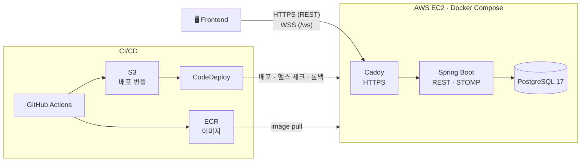
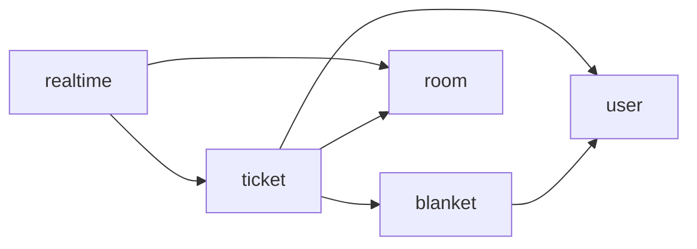

<div align="center">

# 🚉 간이역 대기실 — Backend

**내가 바꿀 수 없는 기다림을, 2D 간이역 대기실에서 다른 승객과 함께**

2026 간지톤 6팀 백엔드 저장소

<br>


<br>


<br>

[🌐 배포 서버](https://api.wait-station.online) · [📖 Swagger](https://api.wait-station.online/swagger-ui/index.html) · [📡 WebSocket 명세](#-websocket-메시지-명세) · [📚 문서](#-문서)

</div>

<br>

## 🐑 서비스 소개

합격 발표, 답장처럼 **내가 어떻게 할 수 없는 기다림**을 혼자 견디지 않도록, 간이역 대기실에서 다른 승객(양)들과 함께 기다리는 서비스예요.

```
🎫 승차권 발급 → 🪑 자동 착석 → 🚂 열차가 지날 때마다 털실 🧶 → 🏁 기다림 종료 → 🧩 담요 조각 선물 → 🛏️ 내 담요
```

| | 기능 | 설명 |
|:---:|---|---|
| 🎫 | **승차권과 대기실** | 대기실과 상태 칩을 고르면 승차권과 호칭(예: `104번 두근두근한 양`)을 받아요 |
| 🪑 | **자동 착석** | 입장하면 서버가 빈 좌석에 앉혀 줘요. 30석이 다 차면 입석으로 기다려요 |
| 🚂 | **열차와 털실** | 공용 시각표로 30분마다 열차가 지나고, 열차 1대마다 털실 1올을 받아요 |
| 📢 | **조합형 방송** | 상황 칩과 상태 칩을 골라 전광판에 방송해요 (30초 쿨다운, 15초 노출) |
| 👍 | **1초 리액션** | 전광판 방송에 끄덕끄덕 · 전해요로 반응하고, 방 전체에 바로 전해져요 |
| 🧶 | **털실 톡톡** | 받은 털실로 도안을 뜨고 역장에게 전달해요 |
| 🧩 | **담요 조각** | 기다림이 끝나면 담요 조각 1칸을 받아 내 담요에 모아요. 공개하면 다른 승객이 볼 수 있어요 |
| 🤖 | **가상 승객** | 대기실이 비어 보이지 않도록 가상 승객이 자동으로 방송해요 |

<br>

## 🛠 기술 스택

| 구분 | 기술 |
|---|---|
| **Language · Framework** | Java 21, Spring Boot 4.1 (Spring MVC, Jackson 3), Lombok |
| **Database** | PostgreSQL 17, Spring Data JPA, Flyway (스키마 · 시드 데이터 마이그레이션) |
| **Auth** | Spring Security, OAuth2 Resource Server (JWT · HS256, Nimbus), 게스트 토큰 |
| **Realtime** | Spring WebSocket, STOMP (내장 Simple Broker), 인메모리 저장소 |
| **API Docs** | springdoc-openapi 3 (Swagger UI) |
| **Test** | JUnit 5, MockMvc, Spring WebSocket Test, Testcontainers (PostgreSQL) |
| **Build** | Gradle 9 |
| **Infra** | AWS EC2 · ECR · S3 · CodeDeploy · SSM Session Manager, Terraform |
| **Runtime** | Docker, Docker Compose (app · db · caddy), Caddy (HTTPS 자동 발급) |
| **CI/CD** | GitHub Actions (PR 빌드 · 테스트, `dev` 자동 배포) |

<br>

## 🏗 아키텍처



- `dev`에 머지되면 GitHub Actions가 이미지를 ECR에 올리고, CodeDeploy가 서버에 배포해요. 헬스 체크(`/actuator/health`)가 실패하면 이전 버전으로 자동 롤백돼요.
- 서버는 SSH 없이 SSM Session Manager로만 접속하고, 80/443 포트만 열려 있어요.
- 실시간 대기실(접속 승객, 좌석, 방송 대기열, 리액션)은 DB 없이 메모리에서만 관리해요.

자세한 내용은 [INFRA.md](docs/INFRA.md)를 봐 주세요.

<br>

## 📦 패키지 구조

```
com.ganzithon.station
├── user       닉네임 + PIN 가입 · 로그인, 담요 공개 설정
├── room       대기실, 상황 칩, NPC, 도안 (시드 데이터)
├── ticket     승차권(기다림 한 건), 열차 · 털실, 털실 톡톡, 전광판 통계
├── blanket    담요 조각, 내 담요, 공개 카드
├── realtime   실시간 대기실 (WebSocket, 메모리만 사용)
└── global     설정, 보안, 예외, 공통 응답
```



화살표 방향으로만 호출해요 (순환 참조 금지). 자세한 규칙은 [DOMAIN.md](docs/DOMAIN.md)에 있어요.

<br>

## 👥 팀

| 이름 | 담당 |
|:---:|---|
| **환희** | `ticket` · `realtime` · `global`, 인프라 · 배포 |
| **상진** | `user` · `blanket` |
| **하빈** | `room` |

<br>

## 🚀 시작하기

> **Docker Desktop을 먼저 켜 두세요.** 로컬 DB와 테스트가 모두 Docker를 써요.

```bash
git clone -b dev https://github.com/2026Ganzi-Thon/2026_GANZITHON_TEAM_06_BE.git
cd 2026_GANZITHON_TEAM_06_BE

docker compose up -d         # 로컬 Postgres
./gradlew bootRun            # http://localhost:8080 (local 프로필, 기본값으로 바로 뜸)
```

- 값을 바꾸고 싶으면 `.env.example`을 복사해 `.env`를 만들어요 (`.env`는 커밋하지 않아요).
- 스키마와 시드 데이터(대기실, 상황 칩, 도안)는 서버가 뜰 때 Flyway가 자동으로 넣어요.
- 로컬 DB가 꼬였으면 `docker compose down -v`로 지우고 다시 띄워요.

### 빌드 · 테스트

```bash
./gradlew build    # PR 올리기 전에 통과해야 해요
```

<br>

## 📚 문서

새 기능을 만들기 전에 꼭 읽어 주세요.

| 문서 | 내용 |
|---|---|
| 🧭 [DOMAIN.md](docs/DOMAIN.md) | 도메인 설계, 기능명세 ID별 담당, 용어집 |
| 🗂 [ERD.md](docs/ERD.md) | 테이블 설계 |
| 🔌 [API_CONVENTION.md](docs/API_CONVENTION.md) | URL, 응답 형식, 에러 코드, 인증, WebSocket 메시지 형식 |
| 🧱 [CODE_CONVENTION.md](docs/CODE_CONVENTION.md) | 레이어 규칙, 예시 코드, 스키마 변경 규칙 |
| 🌿 [GIT_CONVENTION.md](docs/GIT_CONVENTION.md) | 브랜치, 커밋, PR 규칙 |
| ☁️ [INFRA.md](docs/INFRA.md) | 인프라 · 배포 |

### 협업 규칙 요약

- 작업 브랜치는 `dev`에서 `{type}/{기능명세 ID}_{설명}`으로 만들고 (예: `feat/ON-04_ticket_issue`), PR은 `dev`로 올려요.
- PR 제목: `feat: [ON-04] 승차권 발급 API`. 승인 1명 이상, **Squash and merge**.
- `dev`에 머지되면 GitHub Actions가 배포 서버에 자동으로 배포해요.

<br>

## 📡 WebSocket 메시지 명세

Swagger가 WebSocket을 문서화하지 못해서 여기 표로 관리합니다 (형식은 [API_CONVENTION.md](docs/API_CONVENTION.md) 7장).
메시지를 추가·변경하는 PR에서 이 표도 함께 갱신합니다.

### 연결

```js
const client = new Client({
  brokerURL: 'wss://api.wait-station.online/ws',
  // REST와 같은 헤더를 CONNECT에 넣습니다. 로그인했으면 Authorization, 아니면 X-Guest-Token
  connectHeaders: { Authorization: `Bearer ${accessToken}`, 'X-Guest-Token': guestToken },
});
```

- 만료·위조된 계정 토큰이면 연결이 거부됩니다 (STOMP ERROR 후 종료). 토큰을 지우고 다시 연결하세요.
- 연결 후 **`/user/queue/events`와 `/topic/rooms/{roomCode}`를 먼저 구독하고** 입장(join)을 보냅니다.
- 보낼 수 있는 곳은 `/app/...`(아래 표)뿐이고, 구독할 수 있는 곳은 `/topic/rooms/{roomCode}`와 `/user/queue/events`뿐입니다. 다른 목적지로 보낸 SEND·SUBSCRIBE는 서버가 에러 없이 버립니다.
- 방송 문장·호칭 같은 텍스트는 HTML로 넣지 말고 텍스트로만 그려 주세요 (`textContent`, Phaser Text).
- 시각은 모두 epoch ms입니다 (`serverTs`, `startedTs`).
- 대기실 안에서는 폴링하지 않아도 됩니다. 입장, 퇴장, 방송, 리액션 모두 서버가 위 구독 경로로 보내 줍니다.
- 입장 전 방 선택 화면(ON-02)의 방별 인원은 REST `GET /api/v1/rooms/occupancy`로 조회합니다 (토큰 없이 호출 가능, 5초 정도 간격으로 다시 조회).

### 클라이언트 → 서버

| 경로 | body | 설명 |
|---|---|---|
| `/app/rooms/{roomCode}/join` | `{ "ticketId": 1 }` | 입장 (ON-05). 그 대기실의 진행 중인 내 승차권이어야 합니다. 자동으로 좌석에 앉습니다 |
| `/app/rooms/{roomCode}/broadcast` | `{ "situationChipCode": "NO_REPLY_WAITING_REPLY", "moodChip": "FLUTTERING" }` | 조합형 방송 (BR-01). 입장한 방에서만, 두 칩 모두 필수, 30초에 한 번. 고른 상태 칩으로 내 호칭이 바뀝니다 |
| `/app/rooms/{roomCode}/passenger-card` | `{ "ticketNumber": 104 }` | 승객 확대 카드 (MY-05). 같은 방에 입장한 상태에서 승객을 탭하면 나에게만 `PASSENGER_CARD`가 옵니다 |
| `/app/rooms/{roomCode}/reaction` | `{ "broadcastId": "...", "reaction": "NOD" }` | 1초 리액션 (BR-03). 전광판 방송에 반응합니다. `broadcastId`는 `BROADCAST`의 값, `reaction`은 `NOD`(끄덕끄덕)·`SEND`(전해요), 둘 다 필수. 입장한 방에서만. **방송이 전광판에서 내려갔거나 1초 안에 또 보내면 에러 없이 무시합니다** |

### 서버 → 클라이언트

| type | 받는 곳 | 필드 | 언제 |
|---|---|---|---|
| `ROOM_STATE` | `/user/queue/events` | `roomCode`, `myTicketNumber`, `mySeatNumber`, `seatCount`, `passengers[]`, `onAirBroadcast`, `serverTs` | 입장 직후 나에게만. 이 메시지로 화면을 처음 그립니다. `mySeatNumber`는 내 좌석 번호, 서서 기다리면(입석) null이에요. `onAirBroadcast`가 있으면 전광판에 그 방송을 `remainingMs` 동안 보여 주세요 (방송 도중 입장·새로고침) |
| `JOIN` | `/topic/rooms/{roomCode}` | `passenger`, `count`, `serverTs` | 새 승객 입장 (나 포함). 같은 승차권으로 다시 접속하면 오지 않습니다 |
| `LEAVE` | `/topic/rooms/{roomCode}` | `ticketNumber`, `seatNumber`, `count`, `serverTs` | 승객 퇴장 (연결 끊김, 다른 방으로 이동, 기다림 종료). `seatNumber`는 비워진 좌석, 서 있던 승객이면 null. **착석 승객이 나가도 서 있던 승객은 앉지 않습니다** (빈 좌석은 다음에 들어오는 승객이 앉음). 그래서 `seatNumber`가 null인 승객은 끝까지 입석이고, 화면에는 그 승객들을 세어 "입석 +N명"으로만 보여 주면 됩니다 |
| `BROADCAST_ACCEPTED` | `/user/queue/events` | `broadcastId`, `queuePosition`, `cooldownMs`, `displayName`, `serverTs` | 방송 요청이 대기열에 들어감. `cooldownMs` 동안 방송 버튼을 막아 주세요 |
| `BROADCAST` | `/topic/rooms/{roomCode}` | `broadcastId`, `ticketNumber`, `displayName`, `moodChip`, `situationChipCode`, `situationChipLabel`, `sentence`, `displayMs`, `queuedTs`, `serverTs` | 전광판 송출 (BR-02). 대기열 순서대로 `displayMs`(15초) 간격. 보낸 승객 카드의 호칭도 이 값으로 갱신하세요. **`ticketNumber`가 1~99면 시연용 가상 승객**이에요 (방 승객 목록에 없음). 카드 갱신은 건너뛰고 전광판에만 보여 주세요 |
| `REACTION` | `/topic/rooms/{roomCode}` | `broadcastId`, `ticketNumber`, `reaction`, `nodCount`, `sendCount`, `serverTs` | 리액션 (BR-03). `ticketNumber`(반응한 양) 캐릭터 옆에 이모지를 띄우고, 전광판의 끄덕끄덕·전해요 숫자를 `nodCount`·`sendCount`로 바꾸세요. 숫자는 그 방송에 반응한 승객 수예요 (한 명당 종류마다 1번, 다음 방송부터 새로 셈) |
| `PASSENGER_CARD` | `/user/queue/events` | `ticketNumber`, `displayName`, `moodChip`, `startedTs`, `visibility`, `patternCodes`, `trainCount`, `serverTs` | 탭한 승객 카드 (MY-05). `visibility`가 `PUBLIC`이면 조각 도안(`patternCodes`, 최신부터 최대 9개)·승차권 번호·지나간 열차 수(`trainCount`)를, 그 외(`PRIVATE` 비공개, `NO_PIECE` 조각 없음, `GUEST` 비로그인)면 머문 시간(`startedTs`)과 상태 칩만 보여 주세요. 닉네임·종료 표식은 오지 않습니다 |
| `ERROR` | `/user/queue/events` | `code`, `message`, `retryAfterMs`(있을 때만), `serverTs` | 요청 실패. `code`는 REST와 같은 에러 코드 |

<details>
<summary><b>📋 <code>passenger</code> · <code>onAirBroadcast</code> 필드</b></summary>

<br>

`passenger` (`passengers[]`의 원소)

| 필드 | 설명 |
|---|---|
| `ticketNumber` | 승차권 번호. 방 안에서 승객을 구분하는 값 |
| `displayName` | 대기실 호칭. 예: `104번 두근두근한 양` |
| `moodChip` | 상태 칩. 없으면 null |
| `seatNumber` | 좌석 번호 (1부터, 비어 있는 가장 앞 번호에 앉음). 자리가 다 차서 서서 기다리면 null (좌석 수: 환경변수 `SEAT_COUNT`, 기본 30 = 의자 10개 × 3명). 서 있는 승객은 캐릭터를 그리지 않고 "입석 +N명"으로 숫자만 보여 주세요. 서 있는 승객의 `REACTION`은 이모지 없이 전광판 숫자에만 반영됩니다 |
| `startedTs` | 기다림 시작 시각. 머문 시간 계산용 |

`onAirBroadcast` (지금 전광판에 나와 있는 방송, 없으면 null)

| 필드 | 설명 |
|---|---|
| `broadcastId`, `ticketNumber`, `displayName`, `moodChip`, `situationChipCode`, `situationChipLabel`, `sentence` | `BROADCAST`와 같음 |
| `remainingMs` | 전광판에 남은 노출 시간. 지나면 기본 안내 문구로 돌아갑니다 |
| `nodCount`, `sendCount` | 지금까지의 리액션 수 (`REACTION`과 같은 기준) |

null이면 전광판에 기본 안내 문구를 보여 주세요: 방송을 한 번도 안 한 방, 마지막 방송의 노출 시간이 끝난 방, 서버 재시작 직후.

`sentence` 예: `안내 말씀 드립니다. 104번 두근두근한 양님은 지금 '답장을 기다리는 중'입니다.`

</details>

<details>
<summary><b>⚠️ 실패 <code>code</code></b></summary>

<br>

- 승객 카드: `REALTIME_NOT_JOINED`(그 방에 입장 안 함), `REALTIME_PASSENGER_NOT_FOUND`(그 번호의 승객이 방에 없음), `COMMON_INVALID_INPUT`(`ticketNumber` 누락)
- 입장: `TICKET_NOT_FOUND`, `TICKET_FORBIDDEN`(내 승차권 아님), `TICKET_ALREADY_ENDED`, `TICKET_ROOM_MISMATCH`(다른 대기실 승차권), `COMMON_INVALID_INPUT`(형식 오류)
- 리액션: `REALTIME_NOT_JOINED`(그 방에 입장 안 함), `COMMON_INVALID_INPUT`(`broadcastId`·`reaction` 누락, 목록에 없는 `reaction`)
- 방송: `REALTIME_NOT_JOINED`(그 방에 입장 안 함), `BROADCAST_COOLDOWN`(+`retryAfterMs`), `BROADCAST_QUEUE_FULL`(방 대기열 20개 가득), `SITUATION_CHIP_NOT_FOUND`(그 방의 칩이 아님), `TICKET_ALREADY_ENDED`, `COMMON_INVALID_INPUT`(칩 누락)

</details>

> 계정 닉네임과 `ticketId`는 다른 승객에게 보내지 않습니다.
