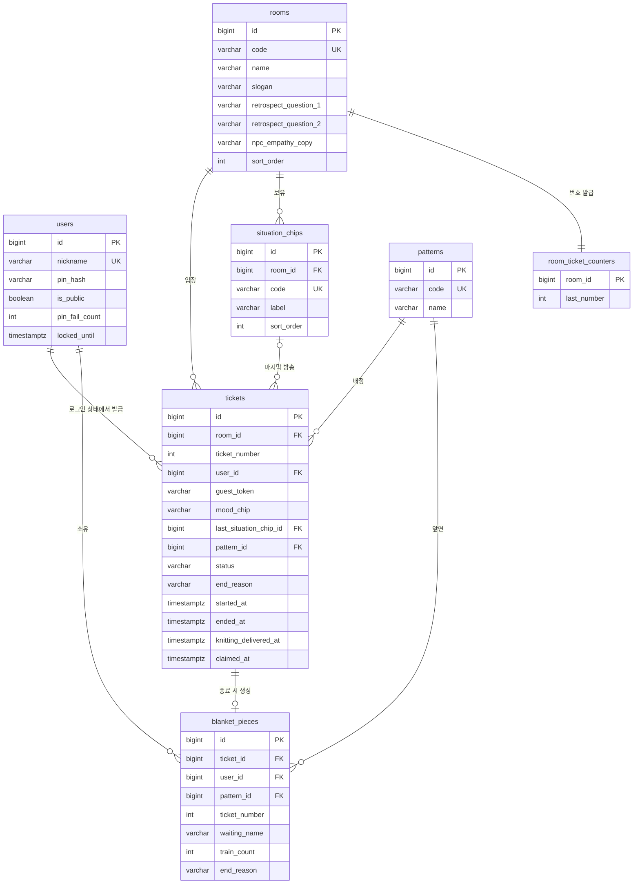

# ERD

> 기준: [DOMAIN.md](./DOMAIN.md). 테이블·컬럼 이름은 snake_case, 시각은 `timestamptz`(UTC 저장)입니다.
> 방송·리액션·접속 승객·좌석은 **DB에 저장하지 않습니다** (`realtime`, 메모리).

## 1. 다이어그램



## 2. 테이블 상세

모든 테이블에 `created_at`, `updated_at`(`BaseTimeEntity`)이 있습니다. 아래 표에서는 생략합니다.

### `users` — 계정 (담당: user)

| 컬럼 | 타입 | 제약 | 설명 |
|---|---|---|---|
| id | bigint | PK, identity | |
| nickname | varchar(12) | not null, **unique** | 로그인 ID 겸 본인용 이름. 대기실에 공개하지 않음 |
| pin_hash | varchar(100) | not null | `PasswordEncoder`로 해시한 PIN. 평문 저장 금지 |
| is_public | boolean | not null, default false | 담요 대기실 공개 여부 (MY-04) |
| pin_fail_count | int | not null, default 0 | 연속 실패 횟수. 로그인 성공 시 0 |
| locked_until | timestamptz | null | 이 시각까지 로그인 잠금 (예: 5회 실패 → 5분) |

- 가입한 계정만 저장합니다. 비로그인 사용자는 이 테이블에 없습니다.

### `rooms` — 대기실 (담당: room, 시드 데이터)

| 컬럼 | 타입 | 제약 | 설명 |
|---|---|---|---|
| id | bigint | PK | |
| code | varchar(30) | not null, unique | `RESULT`, `NO_REPLY`, `GANZITHON_FINAL` |
| name | varchar(30) | not null | 결과발표 / 읽씹 / 간지톤 결선 |
| slogan | varchar(100) | not null | 대기실 상단 문구 |
| retrospect_question_1 | varchar(100) | null | 회고 질문 1 (답은 저장 안 함) |
| retrospect_question_2 | varchar(100) | null | 회고 질문 2 |
| npc_empathy_copy | varchar(100) | null | NPC 터치 공감 문구 (P1) |
| sort_order | int | not null | 대기실 목록 순서 |

- 입장·열차 통과·종료 문구는 방마다 같은 공통 템플릿이라 **프론트 상수**로 둡니다.
- NPC는 방마다 1명이고 이름이 없어서 별도 테이블 없이 공감 문구만 여기에 둡니다.

### `room_ticket_counters` — 대기실별 승차권 번호 (담당: ticket)

| 컬럼 | 타입 | 제약 | 설명 |
|---|---|---|---|
| room_id | bigint | PK, FK → rooms | |
| last_number | int | not null, default 0 | 마지막으로 발급한 번호 |

- 번호 발급은 **한 문장으로 올리고 읽습니다**. 동시에 여러 명이 발급받아도 번호가 겹치지 않습니다.
  ```sql
  UPDATE room_ticket_counters SET last_number = last_number + 1
  WHERE room_id = ? RETURNING last_number;
  ```
- `rooms`는 바뀌지 않는 데이터라 메모리에 올려 두기 때문에, 계속 바뀌는 번호는 별도 테이블로 뺐습니다.

### `situation_chips` — 상황 칩 (담당: room, 시드 데이터)

| 컬럼 | 타입 | 제약 | 설명 |
|---|---|---|---|
| id | bigint | PK | |
| room_id | bigint | not null, FK → rooms | 칩이 속한 대기실 |
| code | varchar(40) | not null, unique | 예: `NO_REPLY_WAITING_ANSWER` |
| label | varchar(50) | not null | 예: 답장 기다리는 중 |
| sort_order | int | not null | |

### `patterns` — 도안 (담당: room, 시드 데이터)

| 컬럼 | 타입 | 제약 | 설명 |
|---|---|---|---|
| id | bigint | PK | |
| code | varchar(30) | not null, unique | 프론트가 그림을 찾는 키. 임시 3개 |
| name | varchar(30) | not null | |

- 도안 크기, 칸 수, 그림은 프론트가 관리합니다.

### `tickets` — 승차권 = 기다림 한 건 (담당: ticket)

| 컬럼 | 타입 | 제약 | 설명 |
|---|---|---|---|
| id | bigint | PK | |
| room_id | bigint | not null, FK → rooms | |
| ticket_number | int | not null | 대기실마다 1번부터. **(room_id, ticket_number) unique** |
| user_id | bigint | null, FK → users | 로그인 상태에서 발급했거나 계정으로 옮긴 경우 |
| guest_token | varchar(64) | null, index | 비로그인 발급 시 서버가 만든 랜덤 값 |
| mood_chip | varchar(30) | null | `MoodChip` enum. 건너뛰면 null, 방송 때 바뀔 수 있음 |
| last_situation_chip_id | bigint | null, FK → situation_chips | 마지막 방송의 상황 칩 (조각의 "기다림 이름"용) |
| pattern_id | bigint | not null, FK → patterns | 발급 때 랜덤 배정 |
| status | varchar(10) | not null | `WAITING` / `ENDED` |
| end_reason | varchar(20) | null | `ANSWERED` / `UNEXPECTED` / `LET_GO`. 종료 시 채움 |
| started_at | timestamptz | not null | 열차·털실·머문 시간 계산의 기준 |
| ended_at | timestamptz | null | |
| knitting_delivered_at | timestamptz | null | 털실 톡톡 "역장에게 전달" 시각 |
| claimed_at | timestamptz | null | 임시 조각을 계정으로 옮긴 시각. 채워지면 다시 옮길 수 없음 |

- **check**: `user_id`와 `guest_token` 중 하나는 반드시 있어야 합니다.
- **check**: `status = 'ENDED'`이면 `end_reason`, `ended_at`이 있어야 합니다.
- 지나간 열차 수·털실 수는 저장하지 않고 `started_at`으로 계산합니다.
- 전광판 통계는 `status = 'ENDED'`를 `end_reason`별로 셉니다 (서버 시작 시 1번, 이후 메모리 카운터).

### `blanket_pieces` — 계정 담요 조각 (담당: blanket)

| 컬럼 | 타입 | 제약 | 설명 |
|---|---|---|---|
| id | bigint | PK | |
| ticket_id | bigint | not null, **unique**, FK → tickets | 기다림 1건 = 조각 1칸 |
| user_id | bigint | not null, FK → users, index | 계정 조각만 저장 |
| pattern_id | bigint | not null, FK → patterns | 앞면 도안 |
| ticket_number | int | not null | 뒷면 기록 (복사본) |
| waiting_name | varchar(50) | not null | 뒷면 기록: 마지막 상황 칩 문구, 없으면 방 이름 |
| train_count | int | not null | 뒷면 기록: 지나간 열차 수 |
| end_reason | varchar(20) | not null | 뒷면 기록: 종료 표식. 공개 카드에는 내보내지 않음 |

- 뒷면 기록 컬럼은 **만들 때 복사하고 이후 바꾸지 않습니다** (Entity에 수정 메서드를 만들지 않음).
- 내 담요 순서는 `created_at` 순입니다.
- 비로그인 조각은 이 테이블에 없습니다 (브라우저 저장).

## 3. enum

| enum | 값 | 저장 |
|---|---|---|
| `TicketStatus` | `WAITING`, `ENDED` | 문자열 |
| `EndReason` | `ANSWERED`, `UNEXPECTED`, `LET_GO` | 문자열 |
| `MoodChip` | 12개 (DOMAIN.md 4-2 표) | 문자열 |

## 4. DB에 두지 않는 것

| 무엇 | 어디에 | 이유 |
|---|---|---|
| 접속 승객, 좌석, 존재감 | `realtime` 메모리 | 접속 중에만 의미 있음 |
| 방송, 리액션, 쿨다운, 송출 대기열 | `realtime` 메모리 | 다시 조회하는 기능 없음 |
| 가상 승객 | `realtime` 메모리 + 설정값 (방마다 2명) | 칩은 그 방의 칩에서 랜덤. 서버 시작 시 생성 |
| 입장·열차·종료 문구 | 프론트 상수 | 모든 방 공통 템플릿 |
| 열차 수, 털실 수, 시간대 | 계산 | `started_at` + 시간 배율 환경변수 |
| 회고 질문 답변 | 저장 안 함 | 다시 보여 주는 곳 없음 |
| 비로그인 담요 조각 | 브라우저 | 기획 V0.2 |
