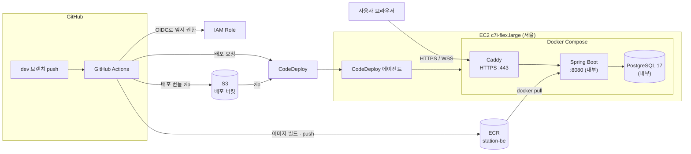

# 인프라 · 배포

> 담당: 환희. EC2 한 대 기준입니다. 비용은 AWS 새 계정의 프리티어 크레딧으로 충당합니다.

## 1. 아키텍처



### 배포 흐름

1. `dev`에 push (PR 머지)
2. GitHub Actions가 **OIDC**로 AWS IAM 역할을 잠깐 맡습니다 (저장된 액세스 키 없음)
3. Docker 이미지를 빌드해 **ECR**에 push (태그: 커밋 SHA)
4. 배포 번들(`appspec.yml`, `docker-compose.yml`, `Caddyfile`, 스크립트, 이미지 주소)을 zip으로 묶어 **S3**에 업로드
5. **CodeDeploy**에 배포 요청 → EC2의 CodeDeploy 에이전트가 번들을 받아 실행
   - `AfterInstall` (`scripts/start.sh`): ECR 로그인 → 새 이미지 pull → `docker compose up -d`
   - `ValidateService` (`scripts/validate.sh`): `/actuator/health`가 `UP`이 될 때까지 대기. 실패하면 배포 실패
6. Actions는 CodeDeploy 배포가 끝날 때까지 기다리고, 결과가 Actions에 표시됩니다

### 구성 요소

| 구성 요소 | 선택 | 이유 |
|---|---|---|
| 서버 | EC2 c7i-flex.large 1대 (2 vCPU, 4GB), 서울 | 프리티어 크레딧 대상. 180명 부하 테스트 기준 여유 있음 |
| 실행 | Docker Compose (app, db, caddy) | 서버 한 대에서 가장 단순 |
| HTTPS | Caddy | 도메인만 있으면 인증서 자동 발급·갱신. WebSocket 설정 불필요 |
| DB | PostgreSQL 컨테이너 + 볼륨 | RDS보다 단순하고 크레딧을 덜 씀. 외부 포트 없음 |
| 이미지 저장소 | ECR | EC2가 IAM 역할로 바로 pull (키·공개 설정 불필요) |
| 배포 | S3 + CodeDeploy | 서버에 SSH로 접속하지 않음. 배포 이력·실패 단계가 콘솔에 남음 |
| AWS 인증 | GitHub OIDC | GitHub에 AWS 키를 저장하지 않음. dev 브랜치에서만 역할을 맡을 수 있음 |
| 서버 접속 | SSM Session Manager | SSH 포트(22)를 열지 않음 |
| CI | PR마다 빌드·테스트 (`ci.yml`) | 깨진 코드가 dev에 들어가지 않게 |

### 환경

| 브랜치 | 배포 |
|---|---|
| `dev` | push될 때마다 서버에 자동 배포 (프론트 연동 서버) |
| `main` | 배포하지 않음. 최종 제출용 기록 |

## 2. 파일 구성

| 파일 | 역할 |
|---|---|
| `Dockerfile` | 앱 이미지 (빌드 단계에서 bootJar, 실행은 JRE만, root가 아닌 사용자) |
| `.dockerignore` | 이미지에 불필요한 파일 제외 |
| `deploy/appspec.yml` | CodeDeploy 설정 (파일 복사 위치, 실행할 스크립트) |
| `deploy/docker-compose.yml` | 운영 서버용 Compose (app, db, caddy). 프로젝트 이름 `station` 고정 |
| `deploy/Caddyfile` | HTTPS, 리버스 프록시, actuator는 health만 공개 |
| `deploy/scripts/start.sh` | ECR 로그인 → pull → 재시작 |
| `deploy/scripts/validate.sh` | 헬스 체크 |
| `deploy/.env.example` | 서버 환경변수 예시. 실제 `.env`는 서버에만 |
| `deploy/setup-ec2.sh` | EC2 첫 세팅 (Docker, AWS CLI, CodeDeploy 에이전트, 스왑, 시간대) |
| `deploy/iam/*.json` | IAM 정책 템플릿 (`<ACCOUNT_ID>`, `<DEPLOY_BUCKET>`만 바꿔서 사용) |
| `.github/workflows/ci.yml` | PR 빌드·테스트 |
| `.github/workflows/deploy.yml` | dev 자동 배포 |

로컬 개발용 `docker-compose.yml`(리포 루트, Postgres만)과 운영용 `deploy/docker-compose.yml`은 다른 파일입니다.

### 서버 폴더

```
/home/ubuntu/station/
├── .env          ← 비밀값. 직접 작성, 권한 600. 배포가 건드리지 않음
└── current/      ← CodeDeploy가 배포마다 덮어씀 (appspec, compose, Caddyfile, scripts, image.env)
```

## 3. 앱이 지켜야 할 것

- `application-prod.yml`에서 환경변수를 **이름 그대로** 읽습니다.
  ```yaml
  # 환경변수 이름: JWT_SECRET, CORS_ALLOWED_ORIGINS, TRAIN_INTERVAL_SECONDS
  # (application.yml이 이 이름으로 읽음. prod에는 기본값을 두지 않음)
  server:
    forward-headers-strategy: framework
  management:
    endpoints.web.exposure.include: health
  ```
- DB 접속 정보는 `SPRING_DATASOURCE_URL / USERNAME / PASSWORD`로 받습니다 (Compose가 넣어 줌).
- `spring-boot-starter-actuator`로 `/actuator/health`가 `UP`을 돌려줘야 합니다 (배포 검증).
- `./gradlew bootJar`로 jar가 하나만 나와야 합니다 (Dockerfile이 `build/libs/*.jar`를 복사).

## 4. 처음 한 번 세팅 (환희)

순서대로 진행합니다. `<ACCOUNT_ID>`는 AWS 계정 ID(12자리), `<DEPLOY_BUCKET>`은 만든 S3 버킷 이름입니다.

### 4-1. 계정

1. AWS 계정 생성
2. **Billing → Budgets**에서 예산 알림 (예: 월 $20, 50%·80%·100%)
3. 리전을 **서울(ap-northeast-2)**로 변경

### 4-2. 저장소

4. **ECR** 리포지토리 생성: 이름 `station-be`, 비공개
   - 수명 주기 정책: "최근 이미지 10개만 유지" (무료 저장 용량을 넘지 않게)
5. **S3** 버킷 생성: 예) `station-deploy-<계정ID>`, 퍼블릭 액세스 차단 유지

### 4-3. IAM

6. **EC2용 역할** (`station-ec2-role`, 신뢰: EC2)
   - AWS 관리형 정책: `AmazonEC2ContainerRegistryReadOnly`, `AmazonSSMManagedInstanceCore`
   - 인라인 정책: `deploy/iam/ec2-bundle-read-policy.json`
7. **CodeDeploy용 역할** (`station-codedeploy-role`, 신뢰: CodeDeploy)
   - AWS 관리형 정책: `AWSCodeDeployRole`
8. **GitHub OIDC 공급자** 추가: IAM → 자격 증명 공급자 → OpenID Connect
   - URL: `https://token.actions.githubusercontent.com`, 대상: `sts.amazonaws.com`
9. **GitHub Actions용 역할** (`station-github-deploy`)
   - 신뢰 정책: `deploy/iam/github-trust-policy.json` (dev 브랜치만 허용)
   - 인라인 정책: `deploy/iam/github-deploy-policy.json`

### 4-4. EC2

10. 인스턴스 생성
    - AMI: Ubuntu Server 24.04 LTS / 유형: c7i-flex.large / 스토리지: gp3 20GB
    - IAM 인스턴스 프로파일: `station-ec2-role`
    - **태그**: `Name = station-dev` (CodeDeploy가 이 태그로 서버를 찾음)
    - 키 페어: 만들지 않아도 됩니다 (접속은 Session Manager)
    - 보안 그룹 인바운드

      | 포트 | 소스 | 용도 |
      |---|---|---|
      | 80 | 0.0.0.0/0 | HTTPS 인증서 발급, HTTP → HTTPS |
      | 443 | 0.0.0.0/0 | HTTPS, WSS |

      22(SSH), 5432(DB), 8080(앱)은 **열지 않습니다.**
11. **탄력적 IP** 할당 후 인스턴스에 연결
12. EC2 콘솔 → 인스턴스 → **연결 → Session Manager**로 접속해서
    ```bash
    sudo -i
    # deploy/setup-ec2.sh 내용을 붙여 넣어 실행 (또는 파일로 만들어 bash setup-ec2.sh)
    ```
13. `.env` 작성
    ```bash
    nano /home/ubuntu/station/.env      # deploy/.env.example 참고
    chmod 600 /home/ubuntu/station/.env
    openssl rand -base64 32             # 비밀번호, JWT_SECRET 만들 때
    ```

### 4-5. CodeDeploy

14. 애플리케이션 생성: 이름 `station`, 플랫폼 EC2/온프레미스
15. 배포 그룹 생성: 이름 `station-dev`
    - 서비스 역할: `station-codedeploy-role`
    - 배포 유형: 현재 위치 (In-place)
    - 환경: Amazon EC2 인스턴스, 태그 `Name = station-dev`
    - 에이전트 설치: 안 함 (4-4에서 설치함)
    - 배포 설정: `CodeDeployDefault.AllAtOnce`
    - 로드 밸런서: 사용 안 함

### 4-6. 도메인

16. DNS에 **A 레코드** 추가: 예) `api.도메인` → 탄력적 IP
    - 도메인이 없으면 무료 DNS 서비스(DuckDNS 등)도 됩니다.
    - DNS가 연결되어야 Caddy가 HTTPS 인증서를 받을 수 있습니다.

### 4-7. GitHub

17. **Settings → Secrets and variables → Actions**

    | 이름 | 값 |
    |---|---|
    | `AWS_ROLE_ARN` | `station-github-deploy` 역할 ARN |
    | `DEPLOY_BUCKET` | S3 버킷 이름 |

18. Actions 탭에서 **Deploy를 수동 실행**해서 첫 배포 확인

## 5. 운영

서버 접속: EC2 콘솔 → 연결 → Session Manager → `sudo -i`

```bash
cd /home/ubuntu/station/current
docker compose ps                  # 상태
docker compose logs -f app         # 앱 로그
docker compose restart app         # 앱만 재시작
docker compose exec db psql -U station station   # DB 접속
```

- **환경변수만 바꿀 때** (열차 간격, CORS): `/home/ubuntu/station/.env` 수정 → `cd current && set -a && . ../.env && . ./image.env && set +a && docker compose up -d app`. 코드 커밋이 필요 없어서 마감(11/20 23:59) 이후에도 바꿀 수 있습니다.
- **이전 버전으로 되돌리기**: CodeDeploy 콘솔에서 이전 성공 배포를 선택해 다시 배포합니다.
- **배포가 실패하면**: CodeDeploy 콘솔 → 배포 → 실패한 이벤트를 열면 스크립트 로그가 보입니다. 서버에서는 `/var/log/aws/codedeploy-agent/codedeploy-agent.log`.

## 6. 보안 체크 (심사 대비)

| 항목 | 적용 |
|---|---|
| 비밀정보 | DB 비밀번호, JWT 키는 서버 `.env`(권한 600)에만. 리포에는 `.env.example`만 |
| CI/CD 권한 | GitHub에 AWS 키를 저장하지 않음. OIDC로 dev 브랜치만 역할을 맡고, 권한은 ECR push·S3 업로드·배포 요청으로 최소화 |
| 네트워크 | 80/443만 열림. SSH·DB·앱 포트 비공개, 서버 접속은 Session Manager |
| 전송 구간 | HTTPS, WSS만 (Caddy 자동 인증서) |
| 이미지 | 비공개 ECR, EC2는 읽기 전용 권한 |
| 컨테이너 | 앱은 root가 아닌 사용자로 실행 |
| 노출 최소화 | actuator는 health만 외부 공개 |

## 7. 비용과 정리

- c7i-flex.large 서울 온디맨드 약 $0.096/시간 (크레딧 차감). EBS, 퍼블릭 IPv4, S3, ECR도 소액 차감. CodeDeploy는 EC2 배포에 요금이 없습니다.
- 해커톤이 끝나면 **인스턴스 종료, 탄력적 IP 해제, ECR 이미지·S3 번들 삭제**를 합니다. 해제하지 않은 탄력적 IP도 요금이 나갑니다.
