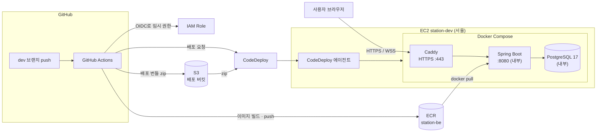

# 인프라 · 배포

> 담당: 환희. EC2 한 대 기준입니다. 비용은 AWS 새 계정의 프리티어 크레딧으로 충당합니다.
> AWS 리소스는 **Terraform**(`infra/terraform/`)으로 만들고 지웁니다. 콘솔에서 직접 만들지 않습니다.

## 1. 아키텍처



### 배포 흐름

1. `dev`에 push (PR 머지)
2. GitHub Actions가 **OIDC**로 AWS IAM 역할을 잠깐 맡습니다 (저장된 액세스 키 없음)
3. Docker 이미지를 빌드해 **ECR**에 push (태그: 커밋 SHA)
4. 배포 번들(`appspec.yml`, `docker-compose.yml`, `Caddyfile`, 스크립트, 이미지 주소)을 zip으로 묶어 **S3**에 업로드
5. **CodeDeploy**에 배포 요청 → EC2의 CodeDeploy 에이전트가 번들을 받아 실행
   - `AfterInstall` (`scripts/start.sh`): `current/.env` 생성 → ECR 로그인 → 새 이미지 pull → `docker compose up -d`
   - `ValidateService` (`scripts/validate.sh`): `/actuator/health`가 `UP`이 될 때까지 대기. 실패하면 배포 실패 → 이전 성공 버전으로 자동 롤백
6. Actions는 CodeDeploy 배포가 끝날 때까지 기다리고, 결과가 Actions에 표시됩니다

### 구성 요소

| 구성 요소 | 선택 | 이유 |
|---|---|---|
| 서버 | EC2 1대, 서울. 평소 **t8i.small**(2GB), 시연 전 **c7i-flex.large**(2 vCPU, 4GB) | 프리티어 크레딧 대상. 시연·부하 테스트 때만 키워서 크레딧 절약 |
| 인프라 코드 | Terraform (`infra/terraform/`, state는 로컬) | 만들기·크기 변경·정리를 명령 한 줄로. 콘솔 실수 방지 |
| 실행 | Docker Compose (app, db, caddy) | 서버 한 대에서 가장 단순 |
| HTTPS | Caddy | 도메인만 있으면 인증서 자동 발급·갱신. WebSocket 설정 불필요 |
| DB | PostgreSQL 컨테이너 + 볼륨 | RDS보다 단순하고 크레딧을 덜 씀. 외부 포트 없음 |
| 이미지 저장소 | ECR | EC2가 IAM 역할로 바로 pull (키·공개 설정 불필요) |
| 배포 | S3 + CodeDeploy | 서버에 SSH로 접속하지 않음. 배포 이력·실패 단계가 콘솔에 남음 |
| AWS 인증 | GitHub OIDC | GitHub에 AWS 키를 저장하지 않음. dev 브랜치에서만 역할을 맡을 수 있음 |
| 서버 접속 | SSM Session Manager | SSH 포트(22)를 열지 않음 |
| CI | PR마다 빌드·테스트 (`ci.yml`) | 깨진 코드가 dev에 들어가지 않게 |

### 환경

| 브랜치 | 배포 |
|---|---|
| `dev` | push될 때마다 서버에 자동 배포 (프론트 연동 서버) |
| `main` | 배포하지 않음. 최종 제출용 기록 |

## 2. 파일 구성

| 파일 | 역할 |
|---|---|
| `Dockerfile` | 앱 이미지 (빌드 단계에서 bootJar, 실행은 JRE만, root가 아닌 사용자, `exec java`로 종료 신호 전달) |
| `.dockerignore` | 이미지에 불필요한 파일 제외 |
| `.gitattributes` | `*.sh`, `*.tf`, `*.yml` 등을 LF로 고정 (Windows에서 커밋해도 서버에서 깨지지 않게) |
| `deploy/appspec.yml` | CodeDeploy 설정 (파일 복사 위치, 실행할 스크립트) |
| `deploy/docker-compose.yml` | 운영 서버용 Compose (app, db, caddy). 프로젝트 이름 `station` 고정. 메모리 한도는 `.env`로 조절 |
| `deploy/Caddyfile` | HTTPS, 리버스 프록시, actuator는 health만 공개 |
| `deploy/scripts/start.sh` | `current/.env` 생성 → ECR 로그인 → pull → 재시작 |
| `deploy/scripts/validate.sh` | 헬스 체크 |
| `deploy/.env.example` | 서버 환경변수 예시 (서버 크기별 메모리 권장값 포함). 실제 `.env`는 서버에만 |
| `deploy/setup-ec2.sh` | EC2 첫 세팅 (Docker, AWS CLI, CodeDeploy 에이전트, 스왑, 시간대). Terraform이 user_data로 첫 부팅 때 실행 |
| `infra/terraform/` | AWS 리소스 전부 (ECR, S3, IAM, 보안 그룹, EC2, 탄력적 IP, CodeDeploy, 예산). 사용법은 [README](../infra/terraform/README.md) |
| `.github/workflows/ci.yml` | PR 빌드·테스트 |
| `.github/workflows/deploy.yml` | dev 자동 배포 |

로컬 개발용 `docker-compose.yml`(리포 루트, Postgres만)과 운영용 `deploy/docker-compose.yml`은 다른 파일입니다.

### 서버 폴더

```
/home/ubuntu/station/
├── .env          ← 비밀값. 직접 작성, 권한 600. 배포가 건드리지 않음
└── current/      ← CodeDeploy가 배포마다 덮어씀 (appspec, compose, Caddyfile, scripts, image.env)
    └── .env      ← start.sh가 배포마다 만듦 (../.env + image.env, root 소유, 권한 600). 직접 고치지 않음
```

`current/.env`가 있어서 `current/` 안에서는 `docker compose ps`, `logs`, `exec`를 바로 쓸 수 있습니다.

## 3. 앱이 지켜야 할 것

- `application.yml`의 prod 구역에서 환경변수를 **이름 그대로** 읽습니다.
  ```yaml
  # 환경변수 이름: JWT_SECRET, CORS_ALLOWED_ORIGINS, TRAIN_INTERVAL_SECONDS
  # (prod에는 기본값을 두지 않음. 빠지면 시작 실패)
  server:
    forward-headers-strategy: framework
  management:
    endpoints.web.exposure.include: health
  ```
- DB 접속 정보는 `SPRING_DATASOURCE_URL / USERNAME / PASSWORD`로 받습니다 (Compose가 넣어 줌).
- `spring-boot-starter-actuator`로 `/actuator/health`가 `UP`을 돌려줘야 합니다 (배포 검증).
- `./gradlew bootJar`로 jar가 하나만 나와야 합니다 (Dockerfile이 `build/libs/*.jar`를 복사).
- `server.shutdown: graceful`: 배포·재시작 때 처리 중인 요청을 마치고 종료합니다 (Compose `stop_grace_period: 40s`).

## 4. 처음 한 번 세팅 (환희)

순서대로 진행합니다. 자세한 Terraform 사용법은 [`infra/terraform/README.md`](../infra/terraform/README.md)를 보세요.

> **DNS(4-4)는 첫 배포(4-6)보다 먼저** 합니다. 배포 검증(`validate.sh`)이 HTTPS로 헬스 체크를 하는데, DNS가 연결되기 전에는 Caddy가 인증서를 받지 못해 배포가 실패합니다.

### 4-1. 준비

1. AWS 계정 생성, 콘솔 오른쪽 위 리전을 **서울(ap-northeast-2)**로
2. 내 PC에 Terraform(1.17.0 이상), AWS CLI(2.32 이상) 설치
3. 로그인 (액세스 키는 만들지 않습니다)
   ```powershell
   aws login --region ap-northeast-2
   aws sts get-caller-identity
   ```
   Terraform이 자격 증명을 못 읽으면: `aws configure export-credentials --format powershell | Invoke-Expression`

### 4-2. terraform apply

4. 변수 파일을 만들고 apply
   ```powershell
   cd infra/terraform
   Copy-Item terraform.tfvars.example terraform.tfvars   # budget_email 채우기
   terraform init
   terraform plan
   terraform apply
   ```
   ECR, S3, IAM(OIDC 포함), 보안 그룹(80/443만), EC2(`Name = station-dev`), 탄력적 IP, CodeDeploy, 예산 알림이 만들어집니다.
   EC2는 첫 부팅 때 `deploy/setup-ec2.sh`를 자동으로 실행합니다 (Docker, AWS CLI, CodeDeploy 에이전트, 스왑).

### 4-3. GitHub Secrets

5. **Settings → Secrets and variables → Actions**에 출력값을 등록

   | 이름 | 값 |
   |---|---|
   | `AWS_ROLE_ARN` | `terraform output -raw github_actions_role_arn` |
   | `DEPLOY_BUCKET` | `terraform output -raw deploy_bucket_name` |

### 4-4. 도메인

6. DNS에 **A 레코드** 추가: 예) `api.도메인` → `terraform output -raw elastic_ip`
   - 도메인이 없으면 무료 DNS 서비스(DuckDNS 등)도 됩니다.
   - `nslookup api.도메인`으로 탄력적 IP가 나오는지 확인합니다.

### 4-5. 서버 `.env`

7. Session Manager로 접속: `terraform output -raw ssm_session_command`의 명령어를 실행하거나, EC2 콘솔 → 인스턴스 → **연결 → Session Manager**
8. 첫 세팅이 끝났는지 확인하고 `.env` 작성
   ```bash
   sudo -i
   cloud-init status --wait            # done이 나와야 함 (로그: /var/log/cloud-init-output.log)
   systemctl is-active codedeploy-agent docker
   openssl rand -base64 32             # 비밀번호, JWT_SECRET 만들 때
   nano /home/ubuntu/station/.env      # deploy/.env.example 참고 (2GB 서버 메모리 값으로)
   chmod 600 /home/ubuntu/station/.env
   ```

### 4-6. 첫 배포

9. Actions 탭에서 **Deploy를 수동 실행**(Run workflow, 브랜치 `dev`)해서 첫 배포 확인
10. `https://api.도메인/actuator/health`가 `{"status":"UP"}`이면 완료

## 5. 운영

서버 접속: `terraform output -raw ssm_session_command` 또는 EC2 콘솔 → 연결 → Session Manager. 접속 후 `sudo -i`

```bash
cd /home/ubuntu/station/current    # current/.env가 있어서 아래 명령을 바로 쓸 수 있음
docker compose ps                  # 상태
docker compose logs -f app         # 앱 로그
docker compose restart app         # 앱만 재시작
docker compose exec db psql -U station station   # DB 접속
```

- **환경변수만 바꿀 때** (열차 간격, CORS, 메모리): `/home/ubuntu/station/.env` 수정 → `bash /home/ubuntu/station/current/scripts/start.sh`. `current/.env`를 다시 만들고 바뀐 컨테이너만 다시 띄웁니다. 코드 커밋이 필요 없어서 마감(11/20 23:59) 이후에도 바꿀 수 있습니다.
  - `current/.env`는 직접 고치지 마세요. 다음 배포나 `start.sh` 실행 때 `../.env`로 덮어씁니다.
- **이전 버전으로 되돌리기**: CodeDeploy 콘솔에서 이전 성공 배포를 선택해 다시 배포합니다. 배포 실패 시에는 자동으로 이전 성공 버전으로 롤백됩니다.
- **배포가 실패하면**: CodeDeploy 콘솔 → 배포 → 실패한 이벤트를 열면 스크립트 로그(헬스 체크 실패 시 app·caddy 로그 포함)가 보입니다. 서버에서는 `/var/log/aws/codedeploy-agent/codedeploy-agent.log`.

### 서버 크기 바꾸기

평소에는 t8i.small(2GB), 시연·부하 테스트 전에는 c7i-flex.large(4GB)로 바꿉니다. 서버가 **몇 분간 중지**되므로 프론트 팀에 미리 알립니다.

1. `infra/terraform/terraform.tfvars`의 `instance_type` 변경
   ```hcl
   instance_type = "c7i-flex.large"
   ```
2. apply
   ```powershell
   terraform plan    # aws_instance.app "update in-place" 1개인지 확인. replace(교체)가 보이면 멈추고 확인
   terraform apply
   ```
   인스턴스가 중지 → 유형 변경 → 시작됩니다. 디스크, DB 볼륨, 탄력적 IP, `.env`는 그대로입니다. 컨테이너는 `restart: unless-stopped`라 부팅 후 자동으로 다시 뜹니다.
3. 서버 `.env`의 메모리 값을 새 크기에 맞춤 (`deploy/.env.example`의 권장값)

   | 항목 | 2GB (t8i.small) | 4GB (c7i-flex.large) |
   |---|---|---|
   | `JAVA_OPTS` | `"-Xms256m -Xmx512m"` | `"-Xms512m -Xmx1536m"` |
   | `APP_MEM_LIMIT` | `900m` | `2200m` |
   | `DB_MEM_LIMIT` | `384m` | `768m` |
4. 반영
   ```bash
   sudo -i
   bash /home/ubuntu/station/current/scripts/start.sh    # current/.env 갱신 + docker compose up -d
   cd /home/ubuntu/station/current && docker compose ps
   ```

줄일 때는 **3번(메모리 값 줄이기)을 먼저** 하고 1~2번을 진행합니다. 큰 메모리 값 그대로 작은 서버에서 뜨면 메모리 부족으로 컨테이너가 죽을 수 있습니다.

## 6. 보안 체크 (심사 대비)

| 항목 | 적용 |
|---|---|
| 비밀정보 | DB 비밀번호, JWT 키는 서버 `.env`(권한 600)에만. 리포에는 `.env.example`만. Terraform state에도 들어가지 않음 |
| CI/CD 권한 | GitHub에 AWS 키를 저장하지 않음. OIDC로 dev 브랜치만 역할을 맡고, 권한은 ECR push(이 리포지토리만)·S3 업로드(`station/`만)·배포 요청(이 배포 그룹만)으로 최소화 |
| 네트워크 | 80/443만 열림. SSH·DB·앱 포트 비공개, 서버 접속은 Session Manager |
| 전송 구간 | HTTPS, WSS만 (Caddy 자동 인증서) |
| 서버 | IMDSv2만 허용, EBS 암호화, 키 페어 없음 |
| 이미지 | 비공개 ECR(push 시 취약점 스캔), EC2는 읽기 전용 권한 |
| 컨테이너 | 앱은 root가 아닌 사용자로 실행 |
| 노출 최소화 | actuator는 health만 외부 공개 |
| 비용 | 월 예산 알림(50/80/100%) |

## 7. 비용과 정리

- c7i-flex.large 서울 온디맨드 약 $0.096/시간 (크레딧 차감). 평소에는 더 작은 t8i.small로 둡니다. EBS, 퍼블릭 IPv4, S3, ECR도 소액 차감. CodeDeploy는 EC2 배포에 요금이 없습니다.
- 해커톤이 끝나면 Terraform으로 한 번에 지웁니다.
  ```powershell
  cd infra/terraform
  terraform destroy
  ```
  EC2(DB 데이터 포함), 탄력적 IP, ECR 이미지, S3 번들, IAM, CodeDeploy, 예산 알림이 모두 삭제됩니다. DB 데이터가 필요하면 먼저 백업합니다:
  `docker compose exec db pg_dump -U station station > /tmp/station.sql` 후 내려받기.
- DNS A 레코드는 도메인 서비스에서 직접 지웁니다.
